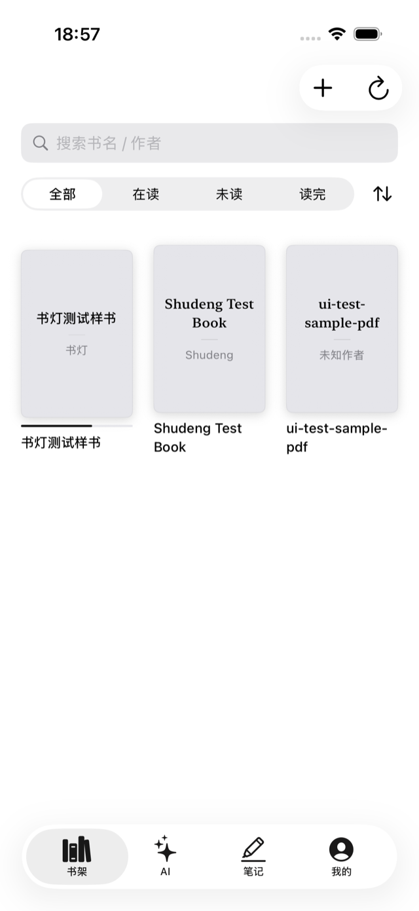
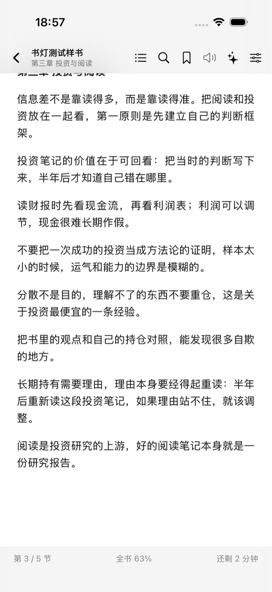
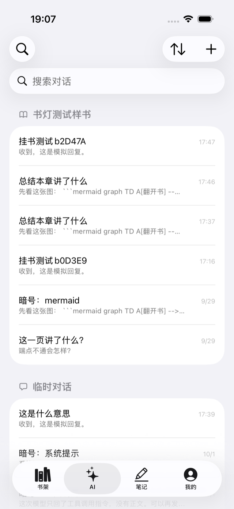
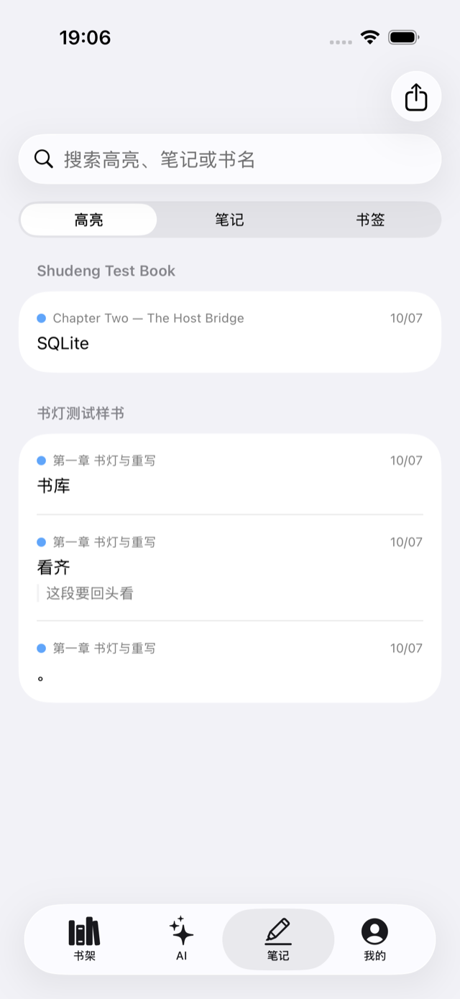
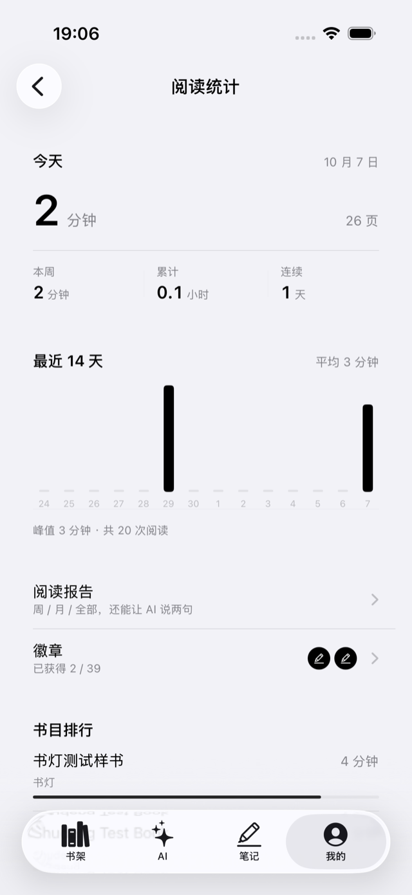

<h1 align="center">书灯 · Shudeng</h1>

<p align="center">
  <strong>本地优先的 AI 阅读器 · 原生 iPhone App</strong><br>
  一盏照书的灯，照亮书里读不懂的地方。
</p>

<p align="center">
  
  
  
  <a href="README.md"></a>
</p>

---

书灯把「读」和「问」放进同一块屏幕：EPUB / PDF 导进来就能读，读到有疑问的地方选中文字直接问 AI，回答带着当前页的上下文；书、笔记、高亮和对话都留在本机。

> 本仓库基于 [ReadAny](https://github.com/codedogQBY/ReadAny)（GPL-3.0-or-later）开发。桌面端 / Web 端代码来自上游，书灯是这套 core 的原生 iOS 重写，位于 `packages/app-ios/`。

## 截图

| 书架 | 阅读 |
| --- | --- |
|  |  |

| AI 对话 | 笔记 | 阅读统计 |
| --- | --- | --- |
|  |  |  |

## 它解决什么

| 读书时的麻烦 | 一般阅读器 | 书灯 |
| --- | --- | --- |
| 读完就忘，想找回某段话 | 只能按关键词搜 | 语义检索，按意思直接找到那一段 |
| 读到不懂的地方 | 切出去查，回来找不到位置 | 选中文字就地提问，AI 带着当前页回答 |
| 笔记散落各处 | 记在别的 App 里 | 高亮 / 笔记 / 书签按书汇总，可导出 |
| 隐私顾虑 | 内容和笔记上云 | 书与笔记只在本机，模型由你自己接 |

## 功能

**书架** — EPUB / PDF 导入（文件、AirDrop），网格封面、按书名或作者搜索、在已建索引的书里做语义检索，筛选（全部 / 在读 / 未读 / 读完）与排序，每本书带阅读进度。

**阅读** — 分页与连续滚动两种翻页；目录、书内搜索、书签；白 / 黑 / 护眼三种主题，字号、行距、页边距可调；底栏给出本章进度、全书百分比和剩余时间；顶部浮层收起后就是干净的正文。

**AI 对话** — 历史按书分组，不指定书就是「临时对话」，新建对话时用 chip 选书或直接开临时对话；选中文字或带着当前页提问，回答流式输出、思考过程可折叠；支持思维导图、Mermaid 图等技能；服务商可选 OpenAI 兼容 / Anthropic / Gemini / 自定义，API Key 只进 Keychain。

**笔记** — 高亮、笔记、书签集中在一页，按书分组、可搜索，支持导出。

**阅读统计** — 今日 / 本周 / 累计时长、连续天数、最近 14 天柱状；阅读报告按周 / 月 / 全部，还能让 AI 说两句；徽章与书目排行。

**朗读** — 系统语音朗读正文、跟读高亮、睡眠定时。

**我的** — 外观（主题 + 主题色）、AI 设置、语义检索（向量模型）、关于与许可证。

## 安装

不上架 App Store，用自签 / 侧载安装（Apple 的签名与 DRM 与 GPLv3 冲突，详见「许可」）。

```bash
git clone https://github.com/andyWang1688/ReadAny.git
cd ReadAny
pnpm install
pnpm ios:core && pnpm ios:assets   # 打包 core 与阅读器资源，产物不入库
```

拿到装机包最快的一条路：

```bash
pnpm ios:ipa   # 用本机 Apple Development 证书 + 开发描述文件出已签名 IPA
```

也可以直接用 Xcode：打开 `packages/app-ios/Shudeng.xcodeproj`，把 Signing 换成自己的 team，插上 iPhone 按 ⌘R。要求 iOS 17+、仅 iPhone。

## 开发

### 架构

| 层 | 选型 | 说明 |
| --- | --- | --- |
| UI | SwiftUI | 全量原生，无 React Native / Expo |
| 逻辑 | `packages/core`（TypeScript） | JavaScriptCore 里直接跑，复用 AI / RAG / 统计 / TTS / EPUB 解析 |
| 阅读渲染 | WKWebView + `packages/foliate-js` | 分页、高亮、笔记、跟读 |
| PDF | PDFKit | 替代 pdf.js |
| 向量 | Apple NLEmbedding | 设备端算向量，不外传 |
| 宿主能力 | Swift | 网络（URLSession 流式 SSE）、SQLite、定时器、Keychain |

装配顺序：`bridge-shim.js`（补 JSC 缺失 API）→ `core.js` → `app-bootstrap.js`（把 Swift 原语包成 `IPlatformService`）。详细说明见 [`packages/app-ios/README.md`](packages/app-ios/README.md)。

### 常用命令

```bash
pnpm ios:core     # 打包 core → CoreBridge/Generated/core.js
pnpm ios:assets   # core.js + reader.html → Shudeng/Resources/
pnpm ios:test     # CoreBridge 测试（core 加载 / LangChain / SQLite / 宿主层 / EPUB 导入 / 流式对话）
pnpm ios:ipa      # 出已签名 IPA

# 在模拟器或真机上跑 XCUITest（模拟器会自动起 mock AI 端点）
bash packages/app-ios/scripts/run-ui-tests.sh <设备 UDID>
```

## 测试

- **CoreBridge（SwiftPM）**：`pnpm ios:test`。真实流式对话那条用例要端点，用 `SHUDENG_TEST_BASE_URL` / `SHUDENG_TEST_API_KEY` / `SHUDENG_TEST_MODEL` 传。
- **XCUITest**：23 条用例覆盖书架、阅读、AI、笔记、统计、设置、导入与卸载重装恢复，`run-ui-tests.sh` 一处跑完。

## 数据与隐私

书、封面、进度、高亮、笔记、对话历史都写在本机（SQLite 与 App 沙盒文件）。只有你主动提问时，才会把「当前页或选中段落 + 对话历史」发给你配置的模型服务，接口地址和 Key 都由你自己填，Key 存在 Keychain。App 没有账号系统，也不做数据回传。

## 许可与致谢

- 本项目沿用 **GPL-3.0-or-later**（见 [LICENSE](LICENSE)）：复用了 ReadAny 的 `packages/core`，整个 App 按 GPL-3.0 分发，随二进制提供对应源码。
- 因为 GPLv3 不接受 Apple 的额外签名与 DRM 限制，分发方式是公开源码 + 自签 / 侧载，不上架 App Store。
- 感谢 [ReadAny](https://github.com/codedogQBY/ReadAny)（core、语义检索、技能系统）与 [foliate-js](https://github.com/johnfactotum/foliate-js)（EPUB 渲染）。
